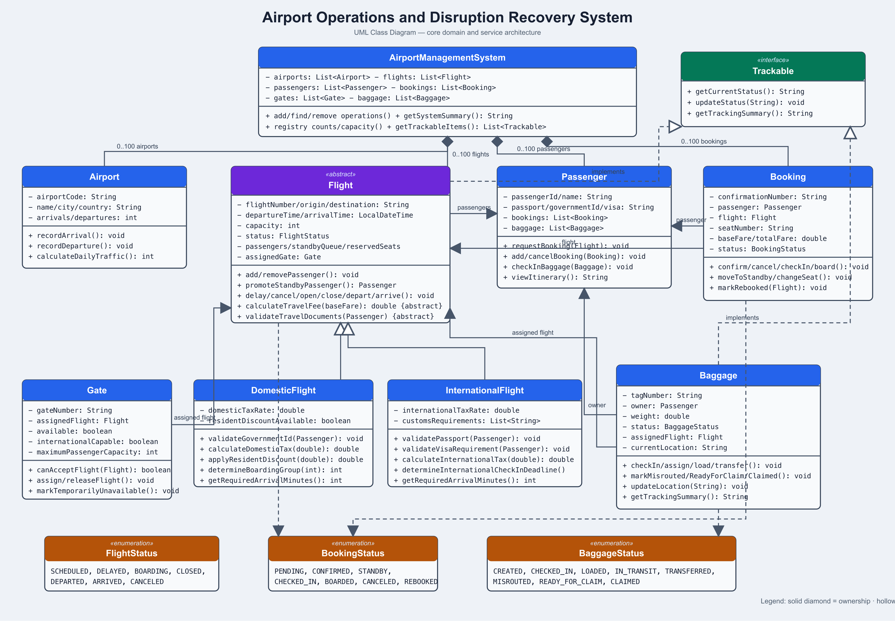

# Airport Operations and Disruption Recovery System

## Overview

This Java 17 console application manages airports, flights, passengers, bookings, gates, baggage, traffic, and operational disruptions.

Airport staff can register operational objects, manage flight and booking lifecycles, assign compatible gates, track baggage, respond to disruptions, and view system summaries.

## Features

- Airport registration, lookup, removal, traffic, and disruptions
- Domestic and international flight management
- Flight delays, cancellation, boarding, departure, and arrival
- Passenger registration and travel-document validation
- Booking confirmation, standby, check-in, boarding, cancellation, seat changes, and rebooking
- Gate assignment with capacity and international compatibility checks
- Baggage check-in, loading, transfer, misrouting, tracking, and claiming
- Polymorphic tracking of flights and baggage
- Duplicate prevention and separate 100-object limits
- One shared Scanner with validated input
- Global `EXIT` command at every prompt

## Design

`Flight` is an abstract class extended by `DomesticFlight` and `InternationalFlight`. Each subclass provides its own document validation, fare calculation, and required arrival time.

`Flight` and `Baggage` implement the `Trackable` interface. The tracking console processes both types polymorphically through `getTrackingSummary()`.

`AirportManagementSystem` maintains separate registries for airports, flights, passengers, bookings, gates, and baggage. Every registry prevents duplicate identifiers and limits storage to 100 objects.

All model fields are private. Business methods validate state transitions before changing object state. Custom exceptions represent duplicate objects, capacity violations, invalid bookings, unavailable gates, full flights, and invalid travel documents.

## Project Structure

```text
src/main/java/edu/sjsu/airport/
|-- config/       Application limits
|-- enums/        Booking and flight statuses
|-- exception/    Custom exceptions
|-- interfaces/   Trackable interface
|-- model/        Domain classes
|-- service/      AirportManagementSystem
`-- ui/           Console application and submenus
```

JUnit tests are under `src/test/java/edu/sjsu/airport/`.

## Requirements

- Java 17 or newer
- Apache Maven 3.9 or newer
- Git

## Installation Instructions

```bash
git clone https://github.com/ikrrispatel/AirportManagement-CS151-Fall-2026.git
cd AirportManagement-CS151-Fall-2026
mvn clean test
mvn clean package
```

## Usage

```bash
java -cp target/classes edu.sjsu.airport.ui.AirportConsoleApplication
```

The main menu includes airport operations plus submenus for flights and passengers, bookings, gates, baggage, and tracking.

Dates use ISO local date-time format, such as `2026-10-20T14:30`. Type `EXIT` at any prompt to terminate safely.

## Validation and Limits

The system validates required values, airport codes, flight times and capacities, finite fares and tax rates, travel documents, lifecycle transitions, seat conflicts, gate compatibility, and baggage transitions.

Each registry stores at most 100 objects and rejects duplicate identifiers.

## Testing

The project contains 152 passing JUnit tests covering models, services, console input, lifecycle transitions, limits, duplicates, cross-class integration, and polymorphism.

Run all tests with:

```bash
mvn clean test
```

GitHub Actions runs the Maven test suite for pushes and pull requests targeting `main`.

## UML Diagram



## Developers

- Krish Patel — Airport, AirportManagementSystem, console UI, limits, integration, and testing
- Kevin Pham — Flight, DomesticFlight, InternationalFlight, FlightStatus, and tracking
- Thinh Nguyen — Passenger, Booking, BookingStatus, and reservation workflows
- Mohammed Rahman — Gate, Baggage, BaggageStatus, and tracking workflows

## Contributions

Development occurs on separately named branches. Changes are reviewed, tested with Maven, and merged into `main` through pull requests.
